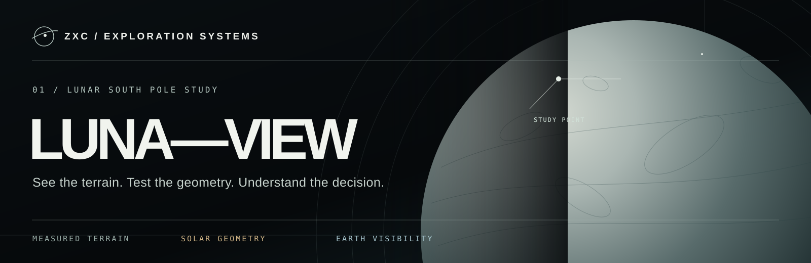
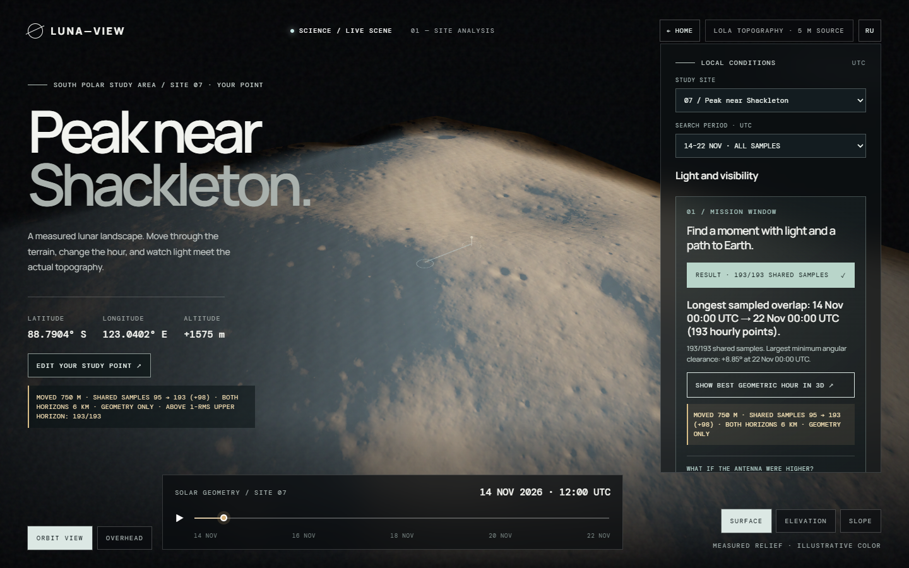
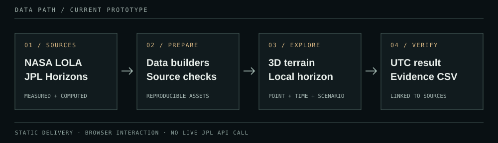

<div align="center">



# LUNA—VIEW

**A visual instrument for exploring lunar south-pole mission geometry.**

Measured terrain, the position of the Sun and Earth, and an explanation you can inspect in 3D.

[Launch the experience](https://pablo228sos.github.io/Nasa_ZXCteam/) · [Open the science view](https://pablo228sos.github.io/Nasa_ZXCteam/science/?site=07&find=1) · [Read in Russian](docs/README.ru.md)

[](https://github.com/pablo228sos/Nasa_ZXCteam/actions/workflows/quality.yml)  

</div>

---

## The question

Where on the lunar south pole can a surface mission see sunlight and Earth at the same time, and what terrain creates or removes that opportunity?

LUNA—VIEW lets a visitor move a study point, test a time interval, and trace the result back to a ridge on measured terrain. The visual scene and numerical result are connected: selecting a different location changes the local horizon, the Sun/Earth timeline, the highlighted blocker, and the downloadable evidence.

This repository is an **independent ZXC project** developed for the NASA Space Apps Challenge 2026. NASA and JPL provide cited scientific data; they do not endorse this application. The opening film is an artistic illustration and is never used as terrain data.

## See it in action

<table>
  <tr>
    <td width="50%"><a href="https://pablo228sos.github.io/Nasa_ZXCteam/"></a></td>
    <td width="50%"><a href="https://pablo228sos.github.io/Nasa_ZXCteam/science/?site=07&amp;find=1"></a></td>
  </tr>
  <tr>
    <td><b>Explore.</b> Enter through a cinematic overview, then compare three studied regions.</td>
    <td><b>Investigate.</b> Move a point in 3D or enter coordinates and see the evidence change.</td>
  </tr>
</table>

| Start here | What to try |
| --- | --- |
| [Site 07 · Peak near Shackleton](https://pablo228sos.github.io/Nasa_ZXCteam/science/?site=07&find=1) | Open **Move the study point** and try the nearby example. Inspect the ridge, timeline, and CSV. |
| [Site 04 · Shackleton rim](https://pablo228sos.github.io/Nasa_ZXCteam/science/?site=04&find=1) | See a site with no shared local Sun/Earth sample in the included interval; use **Show why on the terrain**. |
| [Two-metre antenna scenario](https://pablo228sos.github.io/Nasa_ZXCteam/science/?site=07&find=1&antenna=2) | Compare a change in Earth visibility while ground sunlight stays fixed. |

The three reference centres have **95, 42, and 0 shared hourly geometric samples** respectively at Sites 07, 01, and 04 during 14–22 November 2026 UTC. At the Site 07 example point, 750 m from its centre, the comparable **6 km local-horizon** count changes from 95 to 193 of 193. These are sampled geometric results, not continuous power, communications, or landing-safety forecasts. [Method and qualifications →](docs/SCIENCE.md)

## What is available today

| Capability | Current implementation |
| --- | --- |
| Measured 3D terrain | Three 16 × 16 km south-polar NASA LOLA regions; orbit/overhead cameras, surface/elevation/slope views, optional 2 km detail. |
| Move the study point | Coordinate entry, 3D picking, and a guided example within roughly 2 km of a studied centre. Recalculates the 6 km local horizon from the 5 m source grid. |
| Find a mission window | Hourly Sun/Earth geometry for 14–22 November 2026 UTC, selectable by day, with a visible timeline and strongest sampled hour. |
| Explain the result | Identifies the local blocking ridge and displays a directional terrain profile in the 3D scene. |
| Test a scenario | Compare 0, 2, and 5 m antenna heights for the Earth-horizon geometry. |
| Inspect evidence | Source-linked CSV, shareable URL, 1-RMS input-height sensitivity at ground level, and clear coverage limits. |
| Experience | EN/RU interface, responsive layouts, reduced-motion behaviour, cinematic introductory film. |

**Coverage boundary:** custom points are supported only around the three included study regions. The browser uses bundled, reproducible terrain and ephemeris assets. A coordinate outside the measured envelope produces a coverage message. The 5 m grid is largely interpolated; its pitch is not independent measurement accuracy.

## The intended final experience

The current release proves one complete interaction: **choose a place → test an interval → see what blocks the view → compare a change → export the evidence**. The long-term product is a wider lunar south-pole decision workspace, with:

1. A searchable site atlas backed by explicit DEM footprints, coordinate systems, height datums, and source versions.
2. Multi-scale terrain horizons so distant relief is accounted for, with coverage and uncertainty visible at every zoom level.
3. Solar opportunity, direct-to-Earth visibility, antenna height, and eventually power and communications models presented as separate, inspectable layers.
4. Side-by-side candidate studies with synchronized time, saved scenarios, source citations, and exportable reports.
5. A fast, accessible experience on desktop and mobile, with graceful paths for reduced motion and devices without WebGL.

These are **planned capabilities**, with acceptance criteria in the [implementation roadmap](ROADMAP.md) and [iteration plan](ITERATIONS.ru.md). They are not claims about the current build. The [product vision](docs/VISION.md) explains the full workflow and the scientific gates required before operational interpretations.

## How the current system works



The reference-site horizon samples 360 directions every 50 m to 8 km. A moved point loads an on-demand 5 m height and RMS grid and recalculates those directions to 6 km. Sun and Earth directions at that point are transformed from bundled JPL Horizons vectors. JPL's API policy does not permit embedding its API directly in a website, so the browser does not call it live. [Architecture →](docs/ARCHITECTURE.md) · [Scientific method →](docs/SCIENCE.md)

## Run and verify

No application build or API key is required to explore the bundled study.

```sh
python -m http.server 8000
# open http://localhost:8000/
```

Run the offline data checks and interactive browser checks:

```sh
python -m pip install -r requirements.txt
python scripts/verify_site_data.py
npm ci
npm run test:probe
npm run test:ui
npm run test:probe-ui
```

The UI checks require Google Chrome. Rebuilding the scientific assets additionally requires network access to NASA PGDA and JPL Horizons and is documented in [SCIENCE.md](docs/SCIENCE.md). The GitHub Actions quality workflow runs the offline checks on each push and pull request. Independent checks against the original TIFFs need the ignored `.cache/` source files.

## Repository guide

| Path | Purpose |
| --- | --- |
| [`index.html`](index.html), [`site.css`](site.css), [`site.js`](site.js) | Landing experience and three-site overview. |
| [`science/`](science/) | 3D science interface and versioned derived assets. |
| [`scripts/`](scripts/) | Data generation, source validation, and browser interaction checks. |
| [`media/`](media/) | Generated introductory film and earlier visual studies. |
| [`docs/SCIENCE.md`](docs/SCIENCE.md) | Sources, equations, checks, and scientific limits. |
| [`docs/ARCHITECTURE.md`](docs/ARCHITECTURE.md) | Current data flow, modules, and target architecture. |
| [`docs/VISION.md`](docs/VISION.md) | Full product direction and evidence gates. |
| [`ROADMAP.md`](ROADMAP.md), [`ITERATIONS.ru.md`](ITERATIONS.ru.md) | Planned implementation gates and detailed Russian iterations. |

## Work with us

ZXC welcomes concrete bug reports, scientific corrections, design critiques, and reproducible improvements. Start with [CONTRIBUTING.md](CONTRIBUTING.md) and use the issue templates. For a scientific claim, include coordinates, time, data source, expected result, and a way to reproduce it.

Data, software, and film credits are recorded in [CREDITS.md](CREDITS.md). The repository currently has **no project-wide reuse licence**; the included Three.js files retain their upstream MIT licence. Please contact the maintainers before reusing project code or media beyond the permissions of their individual sources.

<sub>Built by ZXC · Independent NASA Space Apps Challenge 2026 project · Scientific sources and creative media are labelled separately.</sub>
