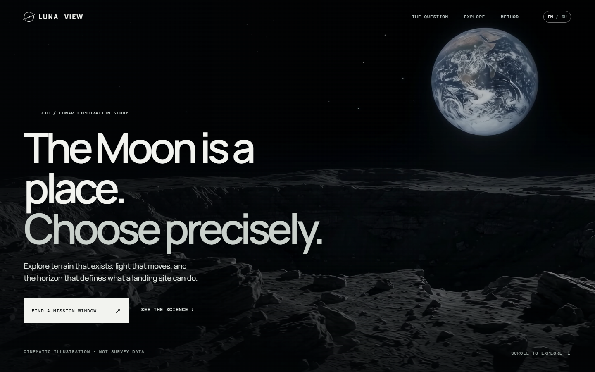
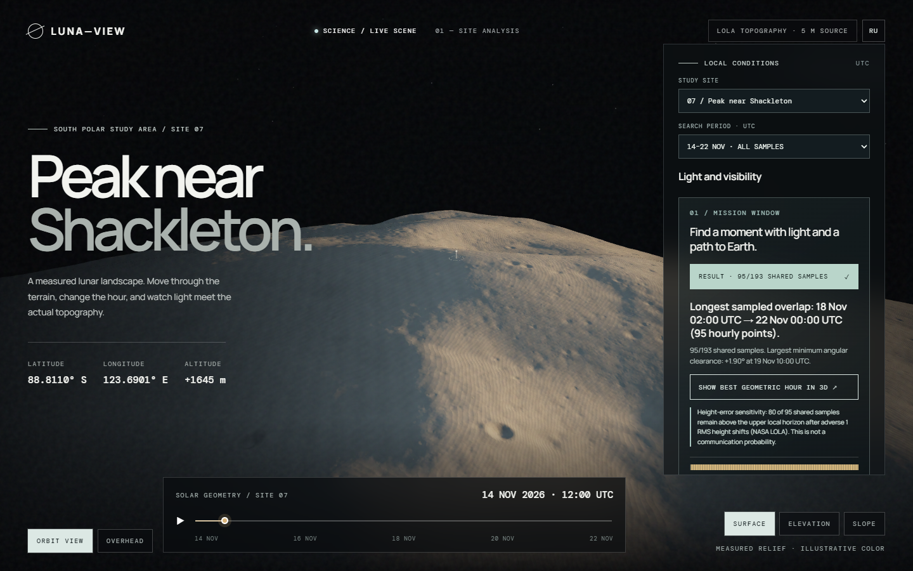
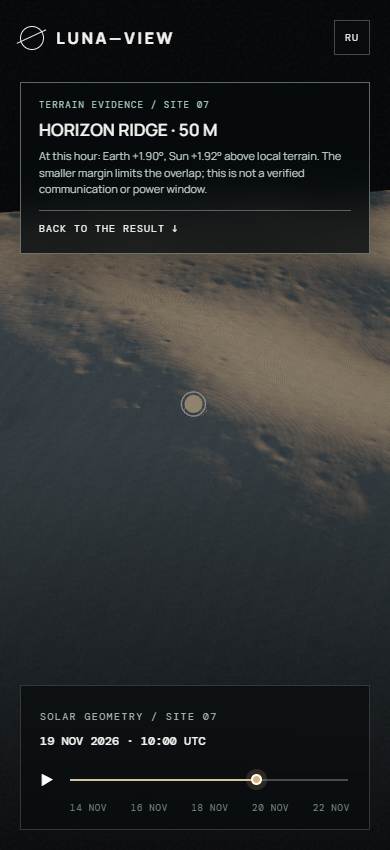
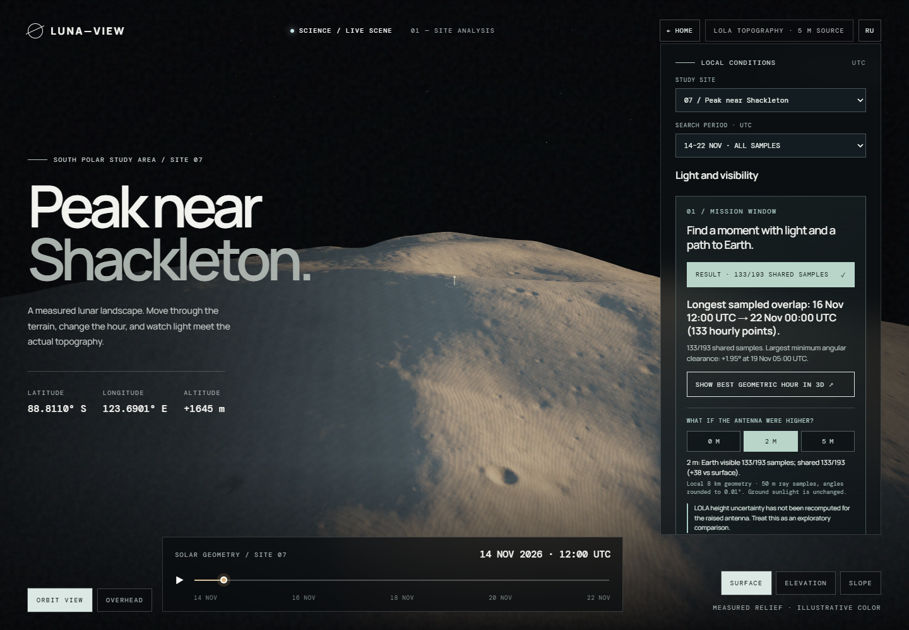

# LUNA—VIEW

**ZXC · [NASA Space Apps Challenge 2026 — Lunar Landing Site Navigator](https://www.spaceappschallenge.org/2026/challenges/lunar-landing-site-navigator/)**

Explore three lunar south-pole study points in measured 3D terrain. Find hourly overlaps of local sunlight and Earth visibility, inspect the ridge behind the result, and export the source-linked evidence.

[Open the live app](https://pablo228sos.github.io/Nasa_ZXCteam/) · [Try Site07: shared window](https://pablo228sos.github.io/Nasa_ZXCteam/science/?site=07&find=1) · [Try Site04: no shared window](https://pablo228sos.github.io/Nasa_ZXCteam/science/?site=04&find=1) · [Watch the 30-second film](media/earth-rim-loop.mp4)

[](https://pablo228sos.github.io/Nasa_ZXCteam/)

*The opening film is generated illustration. It is not a map of a candidate site.*

[](https://pablo228sos.github.io/Nasa_ZXCteam/science/?site=07&find=1)

*The science view uses NASA LOLA elevation data and JPL Horizons Sun/Earth positions. The current result tests local geometry within 8 km at hourly intervals; it is not a power or communication forecast.*

[](https://pablo228sos.github.io/Nasa_ZXCteam/science/?site=07&find=1)

*On phones, “Show why” opens the terrain with the measured horizon ridge marked, its distance and angular clearances, a UTC scrubber, and a direct return to the result.*

[](https://pablo228sos.github.io/Nasa_ZXCteam/science/?site=07&find=1&antenna=2)

*What if the antenna is raised? The 2 m setting recomputes the Earth terrain horizon while sunlight remains evaluated at the ground. This is a local geometric scenario, not a radio link budget.*

## Try the mission-window flow

1. Open the live app and choose a UTC day in the three-site comparison.
2. Open a site in 3D. Links from the comparison open its result with the chosen day already selected.
3. Open the 3D explanation to see the terrain horizon, then optionally load the 2 km detail view or download the CSV.

## Run locally

From this directory:

```sh
python -m http.server 8000
```

Open `http://localhost:8000/`. The main action opens `http://localhost:8000/science/?site=07&find=1`; the selector also offers Sites 01 and 04. A local HTTP server is required because the terrain and ephemeris are fetched as separate files. No build step or API token is needed to view the included study.

For the browser interaction check, install Node dependencies with `npm ci`, then run `npm run test:ui` with Google Chrome installed. The check opens the actual 3D scene at phone, tablet and desktop widths, clicks the terrain modes, changes day/site/language, and checks that the evidence panel clears the controls. It also verifies the landing preview at phone and desktop widths.

## What works now

- Cinematic landing page with the **Earth over a lunar rim** video, native scrolling, responsive layouts, reduced-motion behavior, and EN/RU content. The main action opens Site07's mission-window analysis. A 1080p loop serves large screens; a 720p, 6.1 MB version serves phones. A three-site comparison strip reads the site data files on demand, calculates the 95/42/0 shared hourly samples, and shows synchronized Sun/Earth/both timelines. Visitors can filter the three cards to any bundled UTC day; each card opens its own 3D explanation with that date retained in the URL.
- Interactive 16 × 16 km terrain scenes at **Shackleton rim (NASA PGDA Site04)**, **Connecting ridge (Site01)** and **Peak near Shackleton (Site07)**, with drag orbit, overhead camera, zoom, surface/elevation/slope views and a UTC timeline. The site selector and one-click compare action load each site's own DEM, normal map, horizon and ephemeris.
- Hourly apparent Sun and Earth azimuth/elevation from **JPL Horizons** for 14–22 November 2026. The light direction and readouts change with the selected hour.
- An approximate local terrain-horizon test for the chosen point, evaluated every degree of azimuth and every 50 m out to 8 km, including lunar curvature.
- A height-error sensitivity check derived from each site's NASA PGDA **total-Z RMS uncertainty GeoTIFF**. Along every horizon ray, the screen also tests an upper horizon formed by raising ridge samples and lowering the observer by one reported RMS each. For the full interval, **Site01 18/42** and **Site07 80/95** geometric shared samples remain above that upper local horizon; Site04 has no geometric overlap. This envelope is deliberately adverse but is **not** a statistical confidence interval or a communication guarantee.
- **Find a mission window** checks either all 193 hourly samples or one selected UTC day for simultaneous geometric sunlight and Earth visibility. The selected date is retained when switching sites and in the URL. The result reports the longest run of shared samples and identifies the hour maximizing the smaller of the Sun and Earth angular clearances. The explanation marks the measured ridge and draws the matching horizon profile. An optional 2 × 2 km close-up loads a separate 401 × 401 mesh from the same NASA TIFF only when requested; its 5 m grid does not imply 5 m independent measurement accuracy. For the full interval, shared samples are **Site04 0/193, Site01 42/193, Site07 95/193**. Site07's longest sampled run is **18 Nov 02:00 through 22 Nov 00:00 UTC**; its best balanced sample is **19 Nov 10:00 UTC**, with a minimum clearance of **1.90°**. These are geometric samples, not verified continuous communication or power windows.
- The **antenna-height what-if** control compares 0, 2 and 5 m above the same study point. It recomputes the Earth horizon from the stored 50 m directional terrain profiles and updates the result, UTC chart, 3D ridge explanation, shareable URL and CSV. Ground sunlight does not change. For the full interval, Site07 has **95/193** shared samples at 0 m, **133/193** at 2 m, and **160/193** at 5 m. Site04 still has no shared sample at these heights. This comparison is exploratory: the profile angles are rounded to 0.01°, the horizon covers only 8 km, and the 1-RMS height-error envelope has not been recomputed above the surface.
- An evidence CSV download includes the selected interval's timestamps, observer coordinates, antenna height, Sun/Earth angles, directional terrain horizons, visibility flags and source URLs. The ground-level export also includes lower/upper height-error sensitivity horizons; those columns are blank for raised antennas because that envelope has not been recalculated. A day exports 24 rows; the full interval exports 193.
- Source and display-resolution disclosures in the interface, including source links in the science panel on phones. The generated hero video is explicitly marked as illustration.

## Scientific provenance and limits

| Item | Current implementation |
| --- | --- |
| Terrain | [NASA PGDA high-resolution LOLA south-pole DEMs, Sites 01, 04 and 07](https://pgda.gsfc.nasa.gov/data/LOLA_5mpp/). Projected polar stereographic grid; source sample pitch 5 m. |
| Display geometry | The wide 3D mesh is 384 × 384 samples (41.7 m pitch) derived from the 5 m source. The optional close-up is a 2 × 2 km, 401 × 401 mesh sampled directly from that source at 5 m pitch. A separate 2048² normal map retains finer height variation; it is not an independent measurement. Height is shown at 1:1 scale. |
| Source uncertainty | [PGDA reports that roughly 90% of the 5 m pixels are interpolated](https://pgda.gsfc.nasa.gov/products/78). A 5 m grid is not 5 m independent measurement resolution. |
| Observer | Site04 center: 89.766811° S, 188.130102° E, +769.68 m. Site01 center: 89.463163° S, 222.510447° E, +1944.83 m. Site07 center: 88.811008° S, 123.690068° E, +1645.25 m. Heights are bilinearly sampled at the exact center coordinates, relative to the 1737.4 km lunar reference radius. |
| Ephemeris | [JPL Horizons](https://ssd.jpl.nasa.gov/horizons/) topocentric observer at each site, targets Sun (10) and Earth (399), quantity 4 apparent azimuth/elevation, hourly UTC samples. Site-specific values are bundled in `science/luna_view_site01_data.json`, `science/luna_view_site04_data.json` and `science/luna_view_site07_data.json`. |
| Horizon | Bilinear samples of this DEM along 360 radial directions, with Moon curvature correction. Each direction also records the range and height of the highest blocking ridge. The test considers relief within 8 km only; it is not a complete direct-to-Earth availability prediction. |
| Raised antenna | At 2 or 5 m, each terrain-ray elevation is recalculated as `atan(tan(surface_angle) − antenna_height / range)`, and the highest adjusted ray becomes the Earth horizon. Sunlight stays at ground level. The [independent TIFF check](scripts/verify_antenna_scenario.py) reproduces all three sites' sample counts at both heights; the largest angular difference from the source DEM is 0.0051° or less, attributable to the stored profile rounding. The RMS sensitivity result is shown only for the 0 m baseline. |
| Height-error sensitivity | [NASA PGDA total-Z RMS uncertainty maps](https://pgda.gsfc.nasa.gov/products/78) for the same three 5 m grids. For each ray, lower/upper horizons come from moving the observer and each sampled terrain height by ±1 reported RMS in opposite directions, then taking the highest ray angle. This is a local input sensitivity envelope, **not** a probability, confidence interval or correction for relief beyond 8 km. The source URL and observer RMS are in each site's JSON. |
| Editorial light and color | A fill light and procedural surface tone reveal shape. Neither is a measured reflectance product. Sun direction is ephemeris-driven. |
| Film | `media/earth-rim-loop.mp4` was generated in Google Flow with Omni 1.2 Flash at native 720p, upscaled by Google to 1080p, then locally retimed into a 30-second seamless presentation loop. A separate 720p encode serves phones. The Earth size, crater geometry and stars are **artistic**, not a reconstruction of any study site. Earlier Gemini studies are retained in `media/` for comparison. |

This is a three-point comparison study, not the final challenge-wide site comparison. The date selector covers only the bundled 14–22 November 2026 UTC interval; single-day choices run from the 14th through the 21st, while the 22nd 00:00 endpoint belongs to the full interval. The current window search uses hourly samples and the local 8 km terrain horizon. It does not calculate power yield, full communication availability, long-range occlusion, uncertainty bands or landing suitability scores. The first positive samples at Site01 and Site07 lie close to the modeled horizon; their exact boundaries are not established. Those require additional datasets and validation before they should appear as operational results. See [the iteration plan](ITERATIONS.ru.md) for concrete acceptance criteria.

## Regenerate the science assets

```sh
python -m pip install -r requirements.txt
python scripts/build_site_data.py --site 04
python scripts/build_site_data.py --site 01
python scripts/build_site_data.py --site 07
python scripts/augment_height_sensitivity.py --site 04
python scripts/augment_height_sensitivity.py --site 01
python scripts/augment_height_sensitivity.py --site 07
python scripts/build_close_detail.py
```

The build script downloads the source GeoTIFF into ignored `.cache/`, queries Horizons, and writes the terrain, normal map, and ephemeris JSON in `science/`. The sensitivity script downloads the aligned total-Z RMS GeoTIFF and adds the uncertainty envelope. The close-detail script samples a separate 2 km tile from each cached source DEM. A fresh data build needs network access; each downloaded TIFF is about 41 MB. Run the sensitivity and close-detail steps after rebuilding a site's JSON.

Check the bundled scientific data without network access:

```sh
python scripts/verify_site_data.py
```

This checks all three sets of 360 directional profiles against their recorded horizon maxima and blocker distances, verifies the lower/upper sensitivity horizons, hourly ephemeris spacing and aligned timestamps, and confirms the displayed site results. It checks internal consistency; it is not an independent validation of JPL Horizons or of terrain beyond the supplied tiles.

For a source spot-check using the cached NASA TIFFs and fresh JPL Horizons requests:

```sh
python scripts/validate_source_spots.py
```

This independently reads each site center from the source DEM and total-Z RMS map, reprojects its coordinates, and compares one UTC hour of Sun and Earth angles against fresh Horizons responses. It does not independently validate the orbital model or all 193 hours.

With the three original surface TIFFs present in `.cache/`, verify the 2 m and 5 m antenna scenarios directly against those DEMs:

```sh
python scripts/verify_antenna_scenario.py
```

This checks all 360 directions for each site and confirms that the 193-sample overlap counts agree with the browser's rounded-profile calculation.

## Repository map

```text
index.html / site.css / site.js    Landing page
science/                           Standalone 3D science screen and three sites' derived data
media/                             Flow hero loop and earlier Gemini studies
scripts/build_site_data.py         Reproducible data preparation for Sites 01, 04 and 07
scripts/augment_horizon_blockers.py Local augmentation from the source TIFF
scripts/verify_site_data.py        Offline data-consistency check
scripts/augment_height_sensitivity.py  NASA total-Z RMS sensitivity envelope
scripts/validate_source_spots.py   Source DEM and fresh JPL spot-check
scripts/verify_antenna_scenario.py  Independent raised-antenna DEM check
scripts/smoke-ui.cjs             Chrome interaction and responsive-layout check
scripts/build_close_detail.py       Optional 2 km mesh from the cached source DEM
licenses/three-LICENSE.txt         License for bundled Three.js r180 modules
ROADMAP.md                         Next implementation gates
ITERATIONS.ru.md                   Detailed status, steps and acceptance criteria
```

Three.js r180 is bundled locally so the science screen can run without a CDN. The bundled files retain the original [Three.js MIT license](licenses/three-LICENSE.txt).
