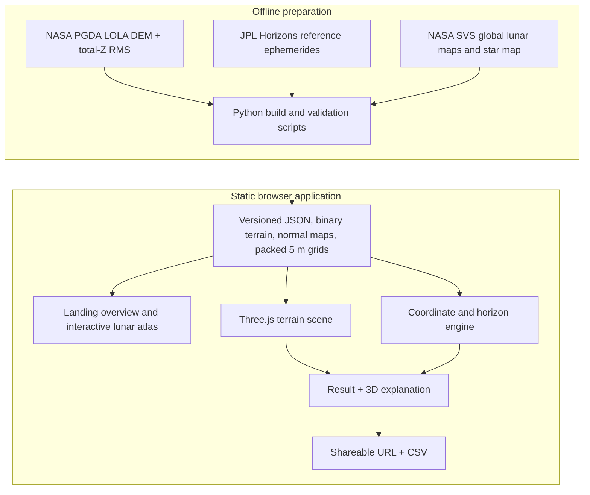

# System architecture

This document separates the shipped static prototype from the architecture we intend to build as geographic coverage and scientific models grow.

## Shipped system

LUNA—VIEW is hosted as static files on GitHub Pages. It does not require an application server, user account, or browser-side NASA/JPL API token. The data pipeline runs ahead of deployment and commits derived assets to `science/`.



| Module | Current responsibility |
| --- | --- |
| `index.html`, `site.css`, `site.js` | Cinematic entry, responsive navigation, three-site comparison, EN/RU copy and routes into science views. |
| `globe.js`, `media/globe/` | NASA-sourced rotatable global Moon, south-pole site selection, hourly solar-light preview, and low-cost fallback. The globe shares the bundled Three.js runtime with the science view. |
| `scripts/build_globe_assets.py` | Downloads and hashes NASA SVS source maps, derives browser color/height/star assets, and transforms bundled JPL local azimuth/elevation samples into globe-frame directions. |
| `science/index.html` | Scene shell, controls, result panel, source disclosure and mobile explanation layout. |
| `science/luna_view_3d_science_reference.js` | Three.js scene, camera, timeline, site switching, mission-window calculation, evidence presentation and export. |
| `science/coordinate_probe.mjs` | Projection, local-basis transformation, packed-grid decoding, bilinear samples, moved-point horizon and RMS envelope. |
| `scripts/build_site_data.py` | Source DEM acquisition, reference-site terrain and JPL Horizons preparation. |
| `scripts/augment_height_sensitivity.py`, `scripts/build_probe_grid.py` | Aligned uncertainty envelope and custom-point grid assets. |
| `scripts/verify_*.py`, `scripts/verify_coordinate_probe.mjs`, `scripts/smoke-*.cjs` | Data, source and browser interaction checks. |

The entry point starts with the film and static interface. The globe loads only when the atlas approaches the viewport, choosing a 2K or 4K color map by screen width. Rendering stops when idle or offscreen. The science view loads the selected site's terrain and ephemeris. The high-resolution point grids load when a visitor asks to move the study point. The optional 2 km close-up is also requested only when opened. All time filtering and local-horizon comparisons then run in the browser.

The global sphere uses a coarse visual elevation map and NASA color imagery. Its three sites lie within roughly one degree of the lunar south pole; a single global cluster expands to three coordinate-linked callouts in polar focus. These points open the separate local 5 m analysis. Global color, star field, visible Sun icon and distances are not scientific measurements of the chosen local hour. The directional light uses precomputed JPL Horizons samples.

## Scientific data contract

Every site must keep its terrain, coordinates, source links, uncertainty information and ephemeris together. The current `luna_view_siteXX_data.json` records site coordinates, map bounds, 360-direction horizon and ridge data, hourly Sun/Earth samples, and provenance. Terrain and normal assets use the same projected footprint. A moved point is derived from that site's source-pitch grid and cannot silently switch to another site's height field.

For future datasets, the contract should explicitly version:

- horizontal coordinate reference and longitude convention;
- height datum and lunar reference radius;
- DEM coverage polygon, sample pitch, interpolation fraction and source release;
- uncertainty semantics and its spatial support;
- ephemeris origin, time scale, sampling cadence and observer definition;
- algorithm version and horizon radius;
- validation cases and observed residuals.

These fields are a **target data schema**. The current JSON contains part of this information, while other definitions live in the build scripts and [scientific method](SCIENCE.md). Consolidating them is a roadmap task.

## Interaction contract

The user should be able to answer four questions without reading the implementation:

1. **Where am I looking?** The scene labels the site, latitude, east longitude, altitude and measured data footprint.
2. **When is the result?** The timeline uses UTC and retains the selected day or hour in the URL.
3. **Why did the result change?** The selected blocker, horizon profile and angular clearance refer to the same point, hour and scenario as the result panel.
4. **What supports the claim?** Source links and the CSV disclose input geometry, model radius and sensitivity.

Changes to site, point, date, camera or antenna must update all dependent readouts together. No visual mode should imply a higher measurement resolution than the source provides. A loading or coverage error must leave the previous result interpretable.

## Target architecture

As the site catalogue grows, the current large scene controller should be divided into explicit modules:

```text
catalog/        site records, coverage and source versions
science/        projection, ephemeris, horizons, scenarios, uncertainty
render/         terrain levels of detail, markers, camera, visual layers
interface/      site, time, comparison, explanation, accessibility
export/         CSV, shareable scenario, evidence report
validation/     control points, cross-source cases, numerical tolerances
```

The names above describe a future refactor, not existing directories. A data-adapter boundary should allow wider terrain sources and separately versioned physical models without rewriting the interface. Each new model needs input provenance, an independent check and a label that states exactly what was calculated.

## Quality gates

| Area | Shipped check | Next gate |
| --- | --- | --- |
| Data consistency | Offline tests of the three bundled horizon/ephemeris sets. | Versioned reference cases across more coordinates and threshold angles. |
| Source comparison | Spot checks against cached original TIFFs and fresh Horizons results. | Broader control-point suite with documented tolerance bands. |
| Browser behaviour | Chrome interaction checks at phone, tablet and desktop widths. | Cross-browser, keyboard-only, screen-reader and non-WebGL paths. |
| Performance | On-demand grids and close detail, separate mobile video encode. | Measured frame-time, transfer and memory budgets across representative devices. |
| Security and privacy | Static app, no sign-in or browser-side third-party API key. | Supply-chain checks and an explicit privacy review if saved scenarios or a backend are introduced. |

The [roadmap](../ROADMAP.md) contains implementation gates. The [contribution guide](../CONTRIBUTING.md) explains how to change calculations without breaking their evidence trail.
