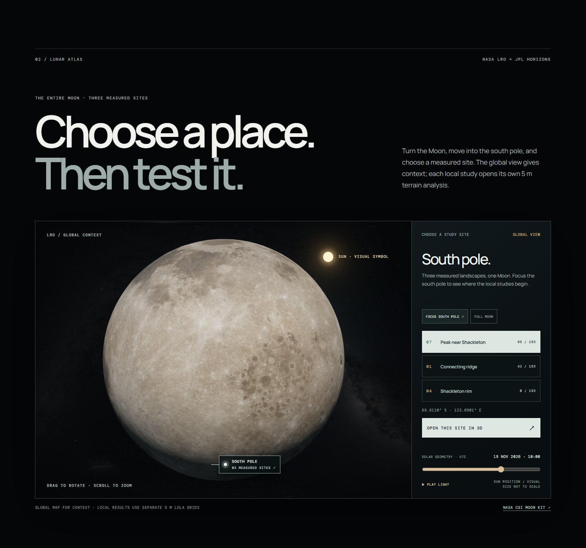
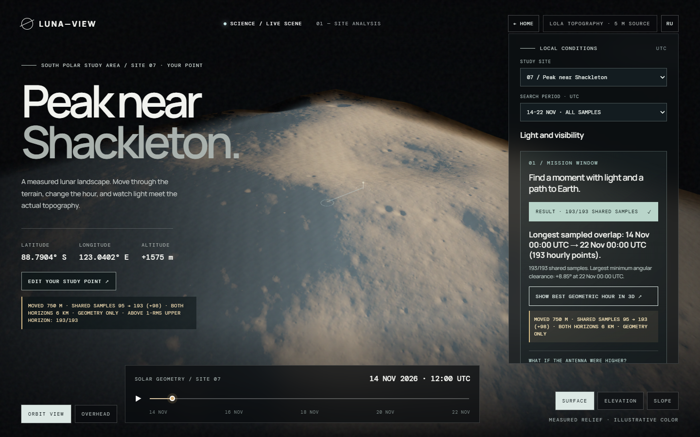

# LUNA—VIEW

**Интерактивный инструмент для исследования геометрии лунного южного полюса.** Мы связываем измеренный рельеф, положения Солнца и Земли, временную шкалу и объяснение результата прямо в 3D-сцене.

[Открыть сайт](https://pablo228sos.github.io/Nasa_ZXCteam/) · [Сразу к научному экрану](https://pablo228sos.github.io/Nasa_ZXCteam/science/?site=07&find=1) · [English README](../README.md)



Проект создаёт команда **ZXC** для NASA Space Apps Challenge 2026. Это независимая работа: NASA и JPL являются источниками данных, но не разработчиками и не партнёрами приложения. Обложка README показывает настоящий экран приложения с картами NASA. Видео на первом экране — сгенерированная художественная иллюстрация; научные результаты из неё не вычисляются.

## Посмотреть за две минуты

1. [Открой лунный атлас](https://pablo228sos.github.io/Nasa_ZXCteam/#terrain), поверни Луну и выбери один из трёх южнополярных участков. Камера приблизится к нему и откроет измеренный 3D-рельеф.
2. На [участке 07](https://pablo228sos.github.io/Nasa_ZXCteam/science/?site=07&find=1) найди совместное окно света и видимости Земли, затем покажи преграждающий гребень в 3D.
3. Передвинь точку готовым примером или вводом координат. Сравни шкалу времени, объяснение на рельефе и выгруженные данные.

Тихо, Коперник, Море Восточное и Циолковский — точки визуального атласа со ссылками на USGS. Локальный расчёт доступен только для участков 01, 04 и 07. [Что работает](#что-уже-работает) · [Научные ограничения](SCIENCE.md) · [План](../ROADMAP.md).

## Что уже работает

| Возможность | Текущая версия |
| --- | --- |
| Глобус Луны | Вращаемая 3D-Луна по глобальным картам NASA LRO/LOLA, приближение южного полюса, три маркера научных участков, четыре объекта из каталога USGS и 193 почасовых направления солнечного освещения. Выбор изученного участка запускает переход к его 3D-симуляции. |
| 3D-рельеф | Три измеренных района южного полюса: Connecting ridge, Shackleton rim и Peak near Shackleton. Доступны орбитальная камера, вид сверху, высота и уклон. |
| Поиск окна миссии | Почасовая геометрическая проверка одновременной видимости Солнца и Земли с 14 по 22 ноября 2026 года, UTC. |
| Своя точка | Ввод координат, выбор точки на 3D-рельефе или готовый пример в радиусе примерно 2 км от центра изученного района. |
| Объяснение в 3D | Местный горизонт, мешающий гребень, его расстояние и угловой просвет связаны с выбранным временем и точкой. |
| Сценарий антенны | Сравнение высот 0, 2 и 5 м для геометрии видимости Земли. |
| Проверяемость | Ссылки на NASA/JPL, оценка чувствительности к высотным данным, CSV с исходными величинами и ссылка на сценарий. |

В исходных центрах трёх участков совместная геометрическая видимость обнаружена в **42, 0 и 95 часовых отсчётах из 193**. В готовом примере для участка 07 смещение точки на 750 м меняет сопоставимый результат с **95 до 193 отсчётов** при одинаковой дальности расчёта горизонта 6 км. Это **не** прогноз непрерывной связи, выработки энергии или безопасной посадки. Рельеф за пределами учтённой дальности не моделируется. [Методика и ограничения](SCIENCE.md).

## Как попробовать

1. На [главной странице](https://pablo228sos.github.io/Nasa_ZXCteam/#terrain) поверни Луну, приблизь южный полюс и выбери участок. Можно поменять час UTC.
2. Открой участок в 3D и нажми «Показать причину на рельефе».
3. Открой «Передвинуть точку», введи координаты или выбери место на рельефе. Можно начать с помеченного готового примера.
4. Сравни временную шкалу, блокирующий гребень и CSV до и после перемещения.

Если координата выходит за пределы трёх изученных районов, приложение сообщает об отсутствии покрытия. Оно не выдаёт выдуманный результат для всей Луны.

Глобус показывает географический контекст и не подменяет локальную модель с шагом 5 м. На полюсе глобальная карта не позволяет различать три участка в масштабе всей Луны, поэтому подписи соединены выносками с их координатами. Значок Солнца, звёздный фон и расстояния декоративны; направление освещения следует подготовленным отсчётам JPL.



## Что мы строим дальше

Финальная концепция — **атлас и рабочее пространство для сравнения мест миссии**. Пользователь сможет найти район по названию или координатам, видеть покрытие и точность каждого источника, сравнить несколько точек при одинаковых условиях и получить отчёт с версиями данных и допущениями. Планируются дальний многомасштабный горизонт, более точный расчёт временных границ, отдельные модели солнечной энергии и связи, доступный мобильный интерфейс и устойчивое поведение без WebGL.

Это **планируемые функции**, а не описание текущей сборки. Для каждой нужны данные, независимые проверки и критерии готовности. Подробности — в [продуктовом видении](VISION.md), [дорожной карте](../ROADMAP.md) и [итерациях](../ITERATIONS.ru.md).

## Научная база

- Глобальный вид: [NASA CGI Moon Kit](https://svs.gsfc.nasa.gov/4720/) и [NASA Deep Star Maps 2020](https://svs.gsfc.nasa.gov/4851/). Глобальная цветовая карта в полярной зоне визуально дополнена данными альбедо LOLA.
- Высоты и total-Z RMS: [NASA PGDA, LOLA 5 м](https://pgda.gsfc.nasa.gov/data/LOLA_5mpp/). Около 90% ячеек этой сетки интерполированы, поэтому шаг 5 м не означает независимую точность 5 м.
- Почасовые направления Солнца и Земли: [JPL Horizons](https://ssd.jpl.nasa.gov/horizons/), заранее подготовленные для опорных точек. Браузер не обращается к Horizons напрямую.
- Местный горизонт: 360 направлений с отсчётами каждые 50 м; дальность 8 км в опорных точках и 6 км в пользовательских.
- Оценка ±1 RMS показывает чувствительность результата к входным высотам. Она не является вероятностью связи.

Полные формулы, проверочные результаты, ограничения и команды воспроизведения находятся в [SCIENCE.md](SCIENCE.md). Схема приложения — в [ARCHITECTURE.md](ARCHITECTURE.md).

## Локальный запуск

```sh
python -m http.server 8000
# открыть http://localhost:8000/
```

Сборка и ключи API для просмотра текущей версии не требуются. Для проверки научных данных и интерфейса:

```sh
python -m pip install -r requirements.txt
python scripts/verify_site_data.py
python scripts/verify_globe_assets.py
npm ci
npm run test:probe
npm run test:ui
npm run test:probe-ui
```

Для браузерных проверок нужен установленный Google Chrome. Полное пересоздание данных из TIFF требует соединения с NASA PGDA и JPL Horizons.

## Команда и использование материалов

Если хочешь помочь, начни с [CONTRIBUTING.md](../CONTRIBUTING.md) и шаблонов задач. Источники и авторство перечислены в [CREDITS.md](../CREDITS.md). У кода и медиа проекта пока **нет общей лицензии на повторное использование**; у включённых модулей Three.js сохранена исходная MIT-лицензия. Перед повторным использованием материалов команды свяжись с сопровождающими проекта.
